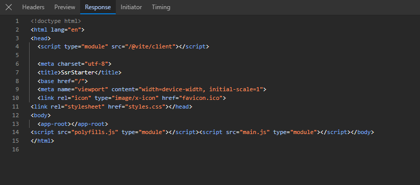
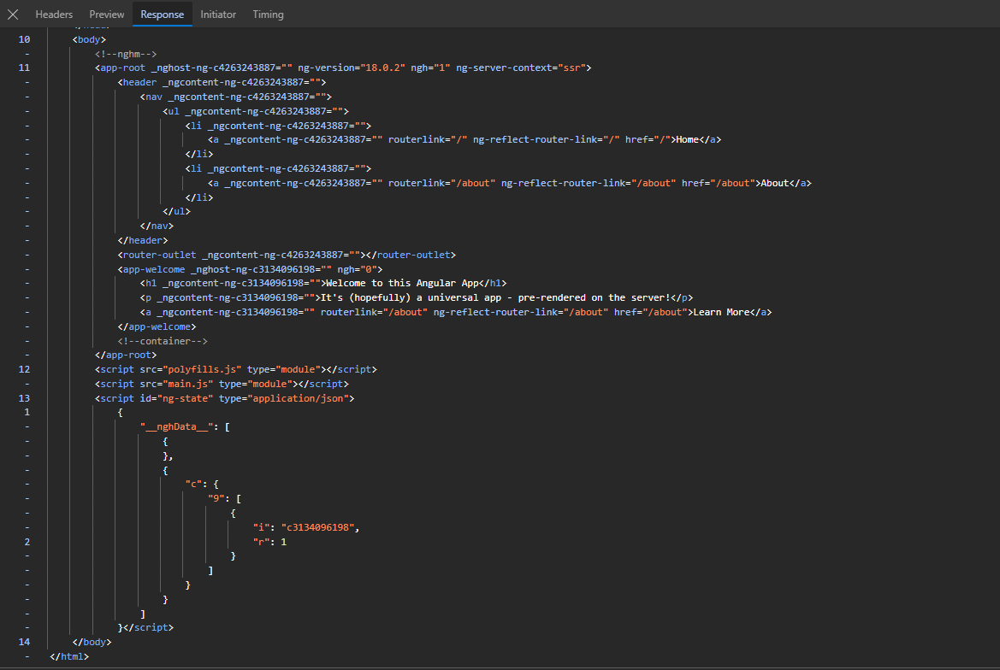

Before Angular 17, there was "Angular Universal". So, if you are still using Angular 16 or earlier, then you can add the "Angular Universal" functionality to an existing app by running - 

    ng add @nguniversal/express-engine

But, starting with Angular 17, the command will be - 

    ng add @angular/ssr

Moreover, if you are starting fresh, then you can tell the CLI to create an Angular Project with SSR enabled by default by writing -

    ng new <project-name> --ssr

And even if you miss the flag "--ssr", Angular CLI will ask you if you want to enable SSR or not.

Since our project uses Angular 18+, we just need to run this command to add ssr functionality - 

    ng add @angular/ssr

It will now ask if you want to proceed with installing the package "@angular/ssr". Enter "Y" and proceed.

Now, once the process ends, you will see that some new files are created by Angular CLI and some are updated. Let's see what all was done.

# 1. src/server.ts

This is the main entry point for server-side rendering in an Angular application. It is a small Express server that is responsible for serving the files and rendering our Angular app on the server.

Let's take a look at the dependencies that this file imports - 

    import {
      AngularNodeAppEngine,
      createNodeRequestHandler,
      isMainModule,
      writeResponseToNodeResponse,
    } from '@angular/ssr/node';
    import express from 'express';
    import { join } from 'node:path';

"express" is a Node.js framework and is a layer that is built on top of Node.js that helps manage servers and routes.

"AngularNodeAppEngine" is the Angular engine that renders our application on the server for a Node.js request. (In the older versions, this was done using something named "CommonEngine", which was replaced by this one.)

"writeResponseToNodeResponse" writes the response created by the Angular engine to the Express response, "isMainModule" tells if this file is the one that was started (as opposed to being imported by something else) and "createNodeRequestHandler" wraps our Express app so that the Angular CLI (and some hosting platforms) can use it.

If you have worked with "Express.js", you will find the code in this file quite familiar. First, we create the Express app and the Angular engine -

    const app = express();
    const angularApp = new AngularNodeAppEngine();

Then, we have the part where we serve the static files from the "browser" folder inside the "dist" folder. This "dist" folder is generated when we run "ng build" -

    app.use(
      express.static(browserDistFolder, {
        maxAge: '1y',
        index: false,
        redirect: false,
      }),
    );

And finally, all the other requests are handled by the Angular engine -

    app.use((req, res, next) => {
      angularApp
        .handle(req)
        .then((response) =>
          response ? writeResponseToNodeResponse(response, res) : next(),
        )
        .catch(next);
    });

So, if the request is for a file like a JavaScript file or an image, it is served from the static files. For every other request, the Angular engine renders the page and sends us the HTML.

At the end of the file, the server is started on the port 4000 (or the port in the "PORT" environment variable), if this file is the main entry point.

# 2. main.server.ts 

    const bootstrap = (context: BootstrapContext) =>
        bootstrapApplication(AppComponent, config, context);

    export default bootstrap;

This file exports one method named "bootstrap" that will bootstrap an instance of an Angular application on the server and renders a standalone component as the application's root component. As we can see, the component passed to it is the "AppComponent".

The "context" (BootstrapContext) is given by the server engine for each request and has to be passed to "bootstrapApplication".

The Angular engine uses this method whenever it needs to render a page.

# 3. app.config.server.ts

    providers: [
        provideServerRendering(withRoutes(serverRoutes))
    ]

This config file is used to define configuration information for the application. And as the name suggests, this one is specifically for server config. The only thing done in this file is to add a provider named "provideServerRendering()" which, if you hover over its name, says that it Sets up providers necessary to enable server rendering functionality for the application.

We also pass it "withRoutes(serverRoutes)" which tells it how to render each route of our application (we will see that in the next point).

    export const config = mergeApplicationConfig(appConfig, serverConfig);

Then, this file exports both the "serverConfig" as well as the "appConfig" which is present in app.config.ts file.

# 4. app.routes.server.ts

    export const serverRoutes: ServerRoute[] = [
      {
        path: '**',
        renderMode: RenderMode.Prerender
      }
    ];

This file decides how each route of our application is rendered. For each route, we set a "renderMode". It can be -

 - RenderMode.Server -> the route is rendered on the server for every request (SSR).
 - RenderMode.Prerender -> the route is rendered once at build time (SSG).
 - RenderMode.Client -> the route is rendered only in the browser (CSR).

By default, the CLI sets all the routes ("**" means all the routes) to be pre-rendered at build time. We will see more about this in the SSG note.

# 5. angular.json

Now, let's talk about the files that are updated after we run the command to add SSR to our project. First is the "angular.json" file. 

We see that inside "build" property's "options", it added these lines - 

    "server": "src/main.server.ts",
    "outputMode": "server",
    "security": {
      "allowedHosts": ["localhost"]
    },
    "ssr": {
      "entry": "src/server.ts"
    }

This defines the entry point of server-side rendering in our Angular project and other things.

The "outputMode" decides what the build produces. With "server", the build produces a server that renders the pages (and it can also have pre-rendered pages). If we set it to "static", we get only static files and no server at all.

The "security" option is the list of the host names that our server accepts. This protects the app from some attacks in which the attacker sends a fake "Host" header in the request. By default, the generated list is empty and only the "localhost" is allowed while running the dev server. But, if you run the built server on your machine, a request with a host that is not in the list will fail with the error 'Header "host" with value "localhost:4000" is not allowed'. That's why we have added "localhost" to the list in our project. When you deploy your app, you have to add the domain of your website to this list.

# 6. tsconfig.app.json

Inside the "tsconfig.app.json", the "include" property has all the ts files in the "src" folder (which has both main.ts and main.server.ts as well as server.ts).

    "include": [
        "src/**/*.ts"
    ],

And inside "types", it adds - 

    "types": [
      "node"
    ]

# 7. package.json

Then of course in the package.json file, the dependencies for the "express" and "@angular/ssr" are added. And it also adds a script to start the server that is built, which we will see in a while.

# 8. app.config.ts

Inside the app.config.ts, one provider is added named "provideClientHydration()". 

This sets up providers necessary to enable hydration functionality for the application. By default, the function enables the recommended set of features for the optimal performance for most of the applications.

# RUNNING THE APPLICATION

Finally, to run the application after we added "ssr" functionality, just run "ng serve".

How can we verify that ssr is working for the initial page?

Well, the initial HTML request should contain application content.

If you open the network tab and reload the page, you will see one "localhost" request which returns an "html" page.

This is how the response looks like for the application that does not use ssr - 

And this is how it looks like for an application that uses ssr - 

So, the content of the website can be seen in the response that we get when we add ssr. 

And that's how SSR works for this initial page. All the scripts and all will be downloaded in the background but we will still see the static content on the page, and this is important when we talk about SEO and user experience.

